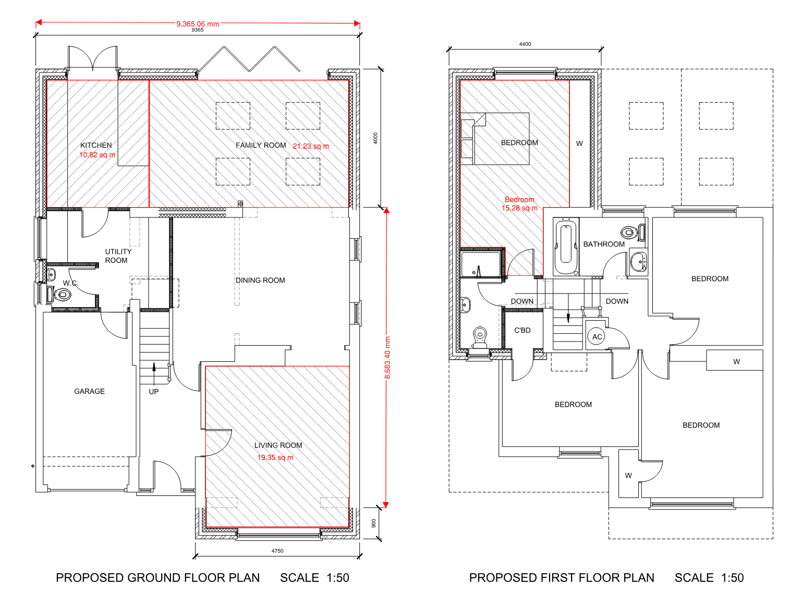
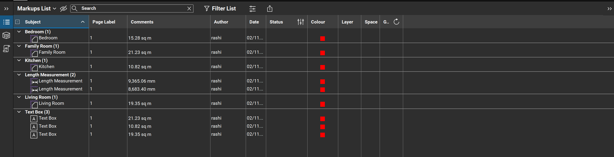
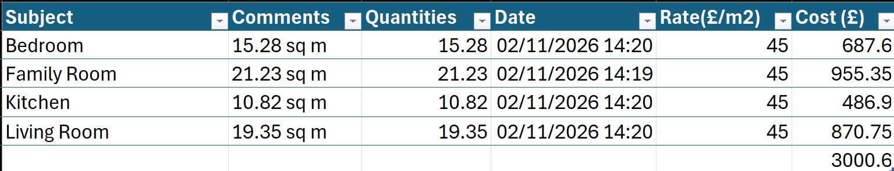

# Quantity Take-off — Bluebeam Revu

A worked construction take-off: measuring floor areas from a scaled architectural
drawing, then building a priced schedule. Demonstrates the core quantity-surveying
workflow — drawing calibration, measurement, quantity scheduling and cost estimation.

Built by Mohammad Mamunor Rashid Tonmoy · github.com/tonCodesData

---

## What this demonstrates

- Calibrating a scaled PDF floor plan to real-world dimensions in Bluebeam Revu
- Taking off room floor areas (m²) using polygon area measurement
- Exporting the measurement schedule and cleaning it in Excel
- Pricing the quantities (area × rate) into a costed take-off

## The take-off in Revu

Floor areas measured directly on the calibrated drawing:

Each measurement captured in the Markups List, ready to export:

## Method

1. Opened a 1:50 architectural floor plan (publicly available practice drawing) in Bluebeam Revu.
2. Calibrated the page scale against a known dimension — a 9365 mm wall — and verified it by re-measuring that wall (returned 9.37 m).
3. Measured floor areas for four rooms using the Area tool.
4. Exported the Markups List to CSV.
5. Cleaned the export in Excel: extracted numeric quantities from unit-tagged text
   (`=VALUE(LEFT(C2,FIND(" ",C2)-1))`), removed export metadata columns, and built a
   rate/cost schedule with a total.

## Result (sample rate)

| Room | Area (m²) | Rate (£/m²) | Cost (£) |
|---|---|---|---|
| Bedroom | 15.28 | 45 | 687.60 |
| Family Room | 21.23 | 45 | 955.35 |
| Kitchen | 10.82 | 45 | 486.90 |
| Living Room | 19.35 | 45 | 870.75 |
| **Total** | **66.68** | | **3,000.60** |

*Rate is illustrative, for demonstration of the pricing workflow.*

The priced schedule built from the export:

## Files

- `floor-plan-takeoff.xlsx` — the priced take-off schedule
- `screenshots/` — Revu drawing with the measured areas, the Markups List, and the Excel schedule

## Skills

Drawing calibration · area take-off · quantity scheduling · cost estimation ·
Excel data cleaning (LEFT / FIND / VALUE) · Bluebeam Revu